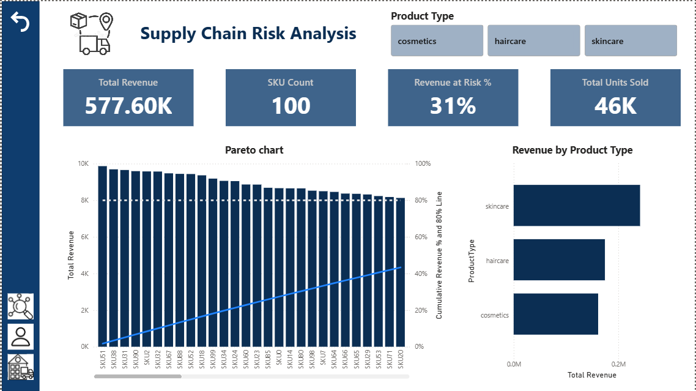
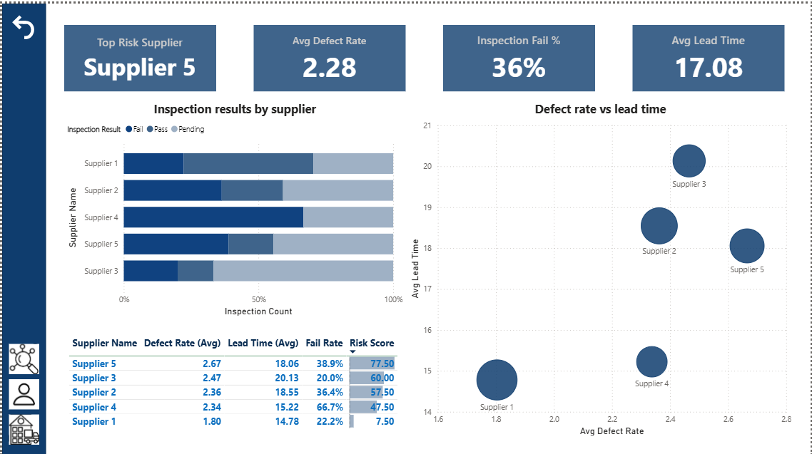
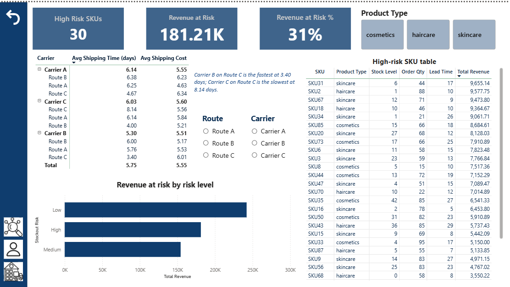

# Supplier Risk & Inventory Analytics | SQL · Power BI

An end-to-end analytics project on a supply chain dataset of **100 SKUs** across three product types: skincare, haircare and cosmetics. The goal is to find **which suppliers carry the most quality risk, which products are at risk of running out, and which delivery routes perform best**, and to turn those findings into practical recommendations.



---

## Business Questions

1. Which product types drive revenue, and how concentrated is revenue across SKUs?
2. Which suppliers carry the highest quality and delivery risk?
3. How many SKUs are at risk of a stock-out, and how much revenue is exposed?
4. Which carriers, routes and transport modes are fastest and cheapest?

---

## Dataset

- **Source:** [Kraggle](https://www.kaggle.com/datasets/amirmotefaker/supply-chain-dataset)
- **Scope:** 100 SKUs, 5 suppliers, 3 carriers, 3 routes, 4 transport modes
- **Fields:** revenue, units sold, stock levels, order quantities, lead times, defect rates, inspection results, shipping times and costs
- This is a public dataset. Revenue is shown in the dataset's original units.

---

## Tools and Workflow

```
Raw data (CSV / Excel)
   → SQL (analysis)
      → Power BI (data model, DAX measures, dashboard)
```

| Tool | Used for |
| --- | --- |
| MySQL | CTEs, window functions, risk scoring, aggregation |
| Power BI | Star-schema data model, DAX measures, 3-page interactive dashboard |

---

## SQL Analysis

All queries are in [`sql/supply_chain_analysis.sql`](sql/supply_chain_analysis.sql).

| Query | Purpose |
| --- | --- |
| Q1 | Revenue and units sold by product type |
| Q2 | Pareto analysis: cumulative revenue share by SKU |
| Q3 | Supplier risk scorecard (defect rate, lead time, inspection failures) |
| Q4 | Stock-out risk by SKU and revenue exposed |
| Q5 | Carrier and transport mode comparison on cost and speed |
| Q6 | Inspection result summary |
| Q7 | Revenue by supplier location |

**Techniques used:** CTEs, window functions (`RANK`, `PERCENT_RANK`, running totals with `ROWS UNBOUNDED PRECEDING`, `SUM() OVER ()` for shares), conditional logic with `CASE`, joins and subqueries.

---

## Supplier Risk Score

Each supplier is scored from 0 (lowest risk) to 100 (highest risk) using three factors:

| Factor | Weight | Why it matters |
| --- | --- | --- |
| Average defect rate | 40% | Direct measure of product quality |
| Average lead time | 30% | Longer lead times increase stock-out risk |
| Inspection failure rate | 30% | Failed inspections signal process problems |

Each factor is ranked across suppliers and converted to a 0–1 scale, then combined using the weights above. The same logic is built in SQL (`PERCENT_RANK`) and in DAX (`RANKX`), and **the results match exactly**.

---

## Stock-out Risk Rule

| Risk level | Rule |
| --- | --- |
| High | Stock covers less than half of one order |
| Medium | Stock covers less than one full order |
| Low | Stock covers at least one full order |

---

## Power BI Dashboard

| Page | What it shows |
| --- | --- |
| **Overview** | KPI cards, Pareto chart of SKU revenue with an 80% reference line, revenue by product type |
| **Supplier Risk** | KPI cards, inspection results by supplier, defect rate vs lead time scatter chart, risk scorecard |
| **Inventory & Logistics** | Stock-out risk KPIs, revenue by risk level, high-risk SKU table, carrier × route matrix |

**Data model:** a star schema with one fact table (`FactSupplyChain`) and three dimension tables (`DimProduct`, `DimSupplier`, `DimShipping`).

**DAX highlights:**
- Dynamic supplier risk score using `RANKX` and `ALLSELECTED`, so the scorecard responds to slicers
- Running-total Pareto measure using `FILTER` and `ALLSELECTED`
- Stock-out risk classification using `SWITCH(TRUE())`
- Top-risk supplier card using `TOPN`

All DAX measures are documented in [`powerbi/dax_measures.md`](powerbi/dax_measures.md).

| | |
| --- | --- |
|  |  |

---

## Key Insights

**Revenue**
1. Total revenue is **577.60K** from **46K units** across 100 SKUs. **Skincare** is the largest product type by revenue, followed by haircare and cosmetics.
2. **Revenue is spread across many products.** [X] of 100 SKUs are needed to reach 80% of revenue, so the classic 80/20 pattern does not apply here.

**Supplier risk**
3. **Supplier 5 has the highest risk score (77.5 out of 100).** It has the highest average defect rate (2.67) and a 38.9% inspection failure rate.
4. **Supplier 4 fails 66.7% of inspections**, far more than any other supplier, but ranks only fourth overall because its defect rate and lead time are moderate.
5. **Supplier 1 is the lowest-risk supplier (7.5)**, with the lowest defect rate (1.80) and the shortest lead time (14.78 days).
6. Across all suppliers, the average defect rate is **2.28**, the average lead time is **17.08 days**, and **36%** of inspections fail.

**Inventory**
7. **30 of 100 SKUs are at high stock-out risk**, with stock covering less than half of one order. These SKUs represent **181.21K in revenue (31% of total)**.
8. Several high-revenue SKUs are almost out of stock. For example, SKU2 has 1 unit against an order quantity of 88, and SKU34 has 1 unit against an order quantity of 21.

**Logistics**
9. **Carrier B on Route C is the fastest combination (3.40 days)**, while **Carrier C on Route C is the slowest (8.14 days)**, more than twice as long.
10. **Shipping costs vary much less than shipping times.** Average costs range from 4.63 to 6.34, while times range from 3.40 to 8.14 days. Speed should drive carrier selection more than cost.

---

## Recommendations

- **Review Supplier 5's quality process**, starting with the root causes of its defects, and increase incoming inspections until defect rates fall.
- **Investigate Supplier 4's inspection failures urgently.** Two out of three inspections fail, which is a serious quality signal even though its overall score is moderate.
- **Use Supplier 1 as the benchmark** for quality and lead time when reviewing other suppliers.
- **Reorder the 30 high-risk SKUs first, prioritising by revenue.** Start with SKU31, SKU2, SKU67, SKU18 and SKU34, the highest-revenue SKUs in the high-risk group.
- **Send Route C shipments through Carrier B**, which is more than twice as fast as Carrier C on the same route (3.40 vs 8.14 days) for a slightly higher cost (6.01 vs 5.56).

---

## Limitations

- **The risk score uses ranks, not actual values.** Ranks show order but not the size of the difference. Supplier 4's failure rate (66.7%) is far above the next supplier (38.9%), but ranking treats that as only one step. Scaling each factor by its actual value (min-max scaling) would capture this better.
- **The weights (40/30/30) are a judgement call.** Different weights would change the ranking, so the score should be reviewed with business stakeholders.
- **Supplier quality fields sit in the supplier table.** Defect rate, lead time and inspection results vary by product, so they behave more like a fact table than a dimension. A cleaner model would separate them into a supplier quality fact table.
- **The stock-out rule assumes `OrderQty` represents expected demand.** The thresholds are simple rules, not a demand forecast.
- **The data is a single snapshot with no dates**, so trends over time cannot be analysed.

---

## Repository Structure

```
├── README.md
├── raw/                               Raw dataset
├── sql/
│   └── supply_chain_analysis.sql      All SQL queries (Q1–Q7)
├── powerbi/                           Power BI report (.pbix), PDF export, DAX measures
└── screenshots/                       Dashboard page images
```

---

## How to Reproduce

1. Load the dataset from `raw/` into MySQL and create the fact and dimension tables.
2. Run the queries in `sql/supply_chain_analysis.sql` in order.
3. Open the `.pbix` file in `powerbi/` with Power BI Desktop to explore the dashboard.

---

## Author

**Tanishka Gaur** · Risk & Compliance professional | PL-300 certified (Microsoft Power BI Data Analyst) · [LinkedIn]([(https://www.linkedin.com/in/tanishkagaur26/)]) · [Email](mailto:gaurtanishka52@gmail.com)
